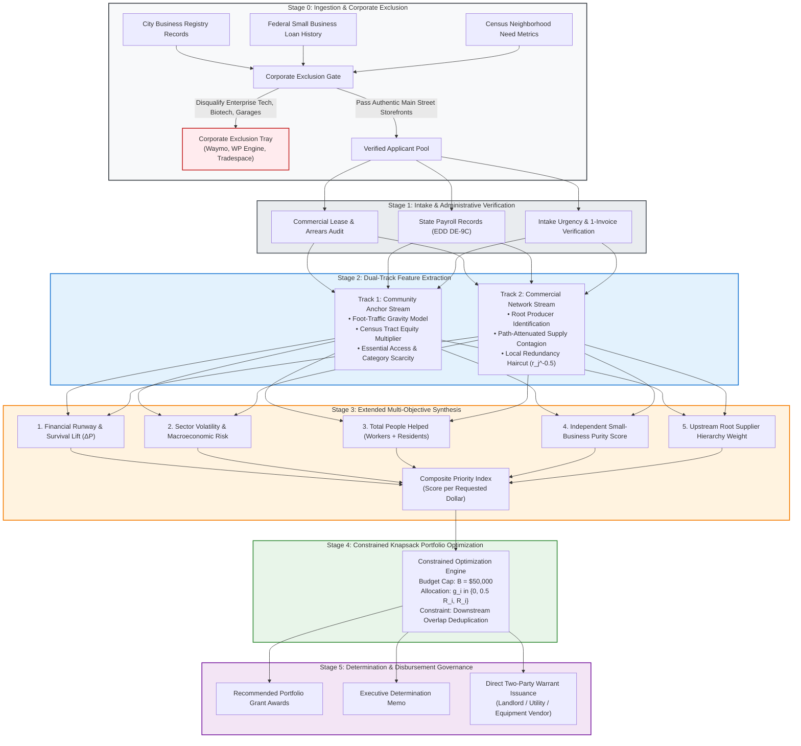
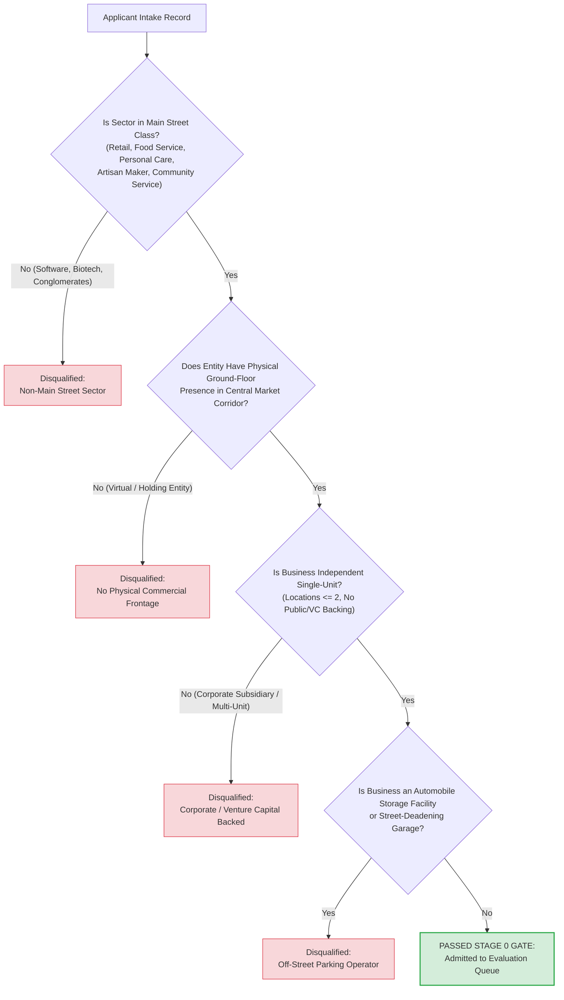
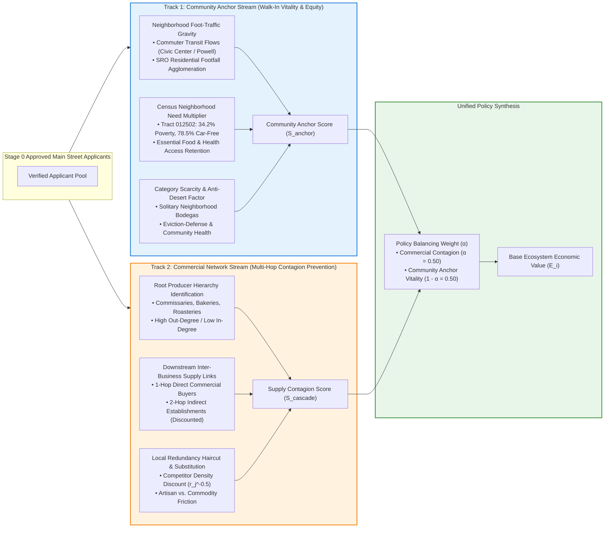
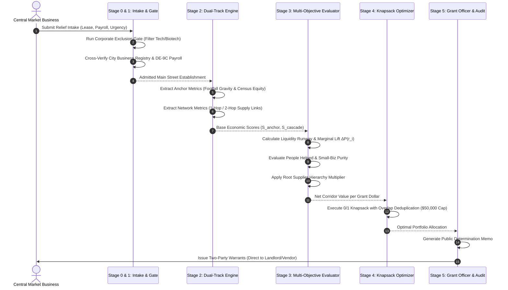
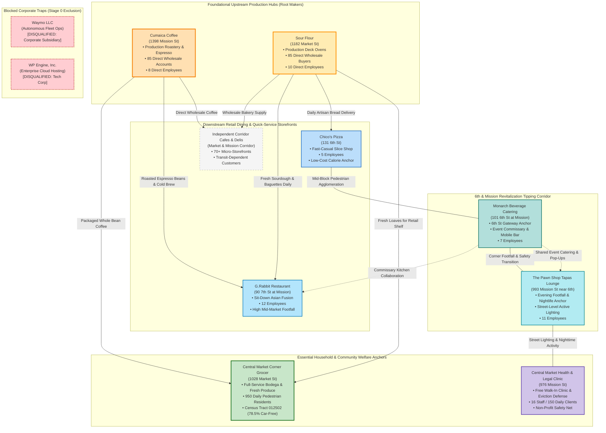
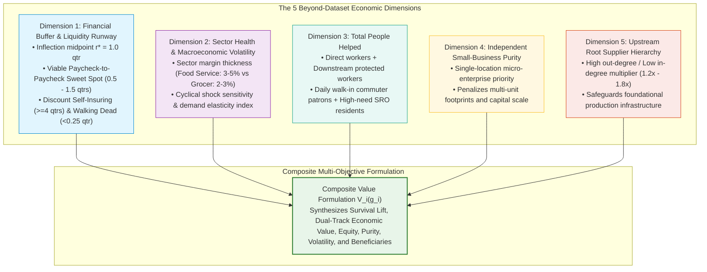
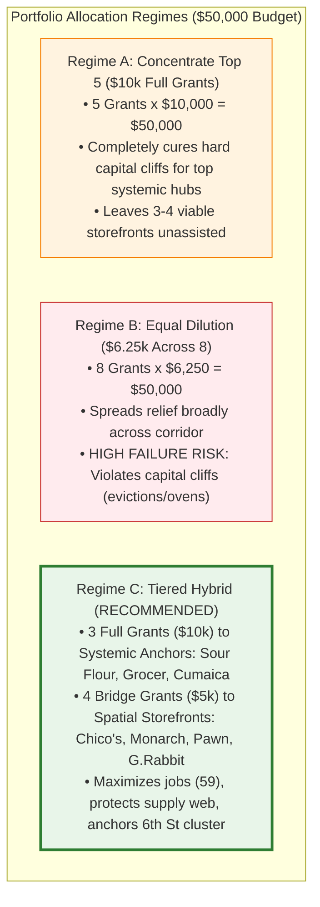

> **Illustrative design record.** Financials, beneficiaries, grant awards and schematic examples below are assumptions, not verified outcomes or city determinations. [Source evidence and corrections](04_SOURCE_EVIDENCE_AND_REVIEW.md) take priority.

# Central Market Small Business Relief Showcase: System Architecture & Triage Framework

**Document Identifier**: `01_ARCHITECTURE_AND_TRIAGE_FRAMEWORK.md`  
**Target Corridor**: Central Market Commercial Corridor, San Francisco, CA  
**Audience**: Technical Systems Architects, Municipal Data Scientists, Grant Officers, and Economic Policy Analysts  
**Core Purpose**: End-to-End Technical & Mathematical Specification of the Dual-Track Triage and Portfolio Optimization Engine  

---

## 1. System Architecture Overview & Pipeline Flow

The Central Market Small Business Relief Engine transforms disparate municipal public records, commercial lease disclosures, micro-economic field surveys, and Census neighborhood vulnerability data into an optimal, defensible portfolio of emergency micro-grants under a strict **$50,000 budget constraint**.

Rather than relying on unweighted administrative heuristics or isolated financial statements, the system models the commercial corridor as an interdependent socio-economic ecosystem. It balances direct community service retention against multi-tier commercial supply chain protection, while ensuring that public dollars are safeguarded from corporate leakage and dilution.

---

## 2. Stage 0: The Corporate Exclusion Gate

A primary vulnerability of naive data pipelines is the **Corporate Masquerade Trap**: municipal tax registries record legal corporate parents without distinguishing between an independent neighborhood bakery and a multinational corporate subsidiary. When national transaction benchmarks are naively applied, corporate cloud platforms, biotech firms, and parking conglomerates falsely capture high network centrality scores.

The **Corporate Exclusion Gate** enforces strict algorithmic and policy filters at the perimeter of the grant pipeline.

### 2.1 Filtering Logic and Rule Hierarchy

### 2.2 Corporate False Positive Audit in Central Market

| Registered Business Name | Registry Address | Nominal Classification | Raw Model Masquerade | Disqualification Rationale & Exclusion Mechanism |
| :--- | :--- | :--- | :--- | :--- |
| **Waymo LLC** | 400 2nd St / 215 Taylor St | Motor Vehicle Mfg / Fleet Ops | Captures 118 downstream edges via fleet maintenance records | **Corporate Tech Subsidiary ($30B+ Valuation)**: Wholly owned subsidiary of Alphabet Inc. Does not represent an independent Main Street commercial storefront. Excluded under Single-Unit Independence Rule. |
| **WP Engine, Inc.** | 300 Howard St / 1161 Mission St | Computer Systems Design / Cloud | Registers 121 reachable nodes via enterprise cloud hub bridging | **Global Tech Corporation ($1B+ Valuation)**: Multi-tenant software hosting provider. Connects to 3 corridor nodes but falsely inherits 114 downstream buyers via cloud infrastructure. Excluded under Non-Storefront Tech Rule. |
| **Tradespace** | 1455 Market St | Data Processing & Cloud Hosting | Models 114 direct corridor buyers in raw transaction tables | **Enterprise Cloud Software Platform**: High venture capitalization. Commercial software provider, not a vulnerable street-level merchant. Excluded under Sector Classification Rule. |
| **Ossium Health, Inc.** | 490 2nd St | Pharmaceutical & Biotech | Models 68 supply edges due to broad chemical sector rollup | **Clinical-Stage Biotechnology Laboratory**: Specializes in cryopreserved human bone marrow therapeutics. Aggregated industry codes conflate lab therapeutics with commercial cleaning soap. Excluded under Biotech Sector Rule. |
| **Impark / Propark America** | 945 Market St / Various | Commercial Parking Management | Models 42 commercial links under broad personal services | **National Commercial Parking Conglomerate**: Vehicle parking facilities deaden pedestrian activation, generate zero artisan value, and operate under national concessionaires. Excluded under Parking Garage Rule. |

---

## 3. The Dual-Track Triage Architecture

Once corporate false positives are eliminated, legitimate applicants enter the **Dual-Track Triage Architecture**. This structure reconciles two distinct economic forces:
1. **Track 1 (Community Anchor Stream)**: Prioritizes consumer-facing establishments that anchor pedestrian foot traffic and provide essential access to low-income, transit-dependent residents.
2. **Track 2 (Commercial Network Stream)**: Prioritizes upstream commercial producers whose failure would trigger cascading supply failures across downstream corridor restaurants and cafes.

### 3.1 Mathematical Formulation of the Dual Tracks

#### Track 1: Community Anchor Score ($S_{\text{anchor}}$)
For each consumer-facing establishment $i$, the anchor score measures pedestrian gravity, transit commuter draw, and essential neighborhood access:

$$S_{\text{anchor}}(i) = M_{\text{equity}}(\text{tract}_i) \cdot \left[ \gamma_{\text{transit}} \cdot G_{\text{transit}}(i) + \gamma_{\text{ped}} \cdot G_{\text{ped}}(i) + \gamma_{\text{scarcity}} \cdot C_{\text{scarcity}}(i) \right]$$

Where:
- $G_{\text{transit}}(i) \in [0, 100]$ quantifies pedestrian commuter capture from the Civic Center and Powell Street BART/Muni subway portals within a 500-meter radius.
- $G_{\text{ped}}(i) \in [0, 100]$ captures walk-in residential footfall density, particularly from dense Single Room Occupancy (SRO) housing blocks along 6th, 7th, and Mission Streets.
- $C_{\text{scarcity}}(i) \ge 1.0$ is the **Category Scarcity Multiplier**. If establishment $i$ is the only fresh grocery provider or walk-in community clinic within a 400-meter walking radius in a high-poverty tract, $C_{\text{scarcity}} = 2.0$.
- $M_{\text{equity}}(\text{tract}_i)$ is the **Census Neighborhood Equity Multiplier**:
  $$M_{\text{equity}}(\text{tract}_i) = 1.0 + \lambda_1 \cdot \text{PovertyRate}(\text{tract}_i) + \lambda_2 \cdot \text{ZeroVehicleShare}(\text{tract}_i)$$
  In Tract 012502 (Poverty Rate = 34.2%, Zero-Vehicle Rate = 78.5%), calibrated parameters ($\lambda_1 = 1.0, \lambda_2 = 0.5$) yield $M_{\text{equity}} \approx 1.73$, prioritizing essential storefronts in neighborhoods with zero private vehicle mobility.

#### Track 2: Commercial Network Contagion Score ($S_{\text{cascade}}$)
For each commercial supplier $i$, the contagion score models the systemic disruption triggered across downstream buyers if supplier $i$ closes:

$$S_{\text{cascade}}(i) = \sum_{j \in N_1^+(i)} w_{ij} \cdot r_j^{-0.5} \cdot (1 - \theta_{\text{ext}}) \cdot \text{Impact}(j) + \beta \sum_{k \in N_2^+(i)} w_{ik}^{(2)} \cdot r_k^{-0.5} \cdot (1 - \theta_{\text{ext}}) \cdot \text{Impact}(k)$$

Where:
- $N_1^+(i)$ denotes the set of direct commercial buyers (1-hop), and $N_2^+(i)$ denotes indirect downstream establishments (2-hop).
- $w_{ij}$ represents the normalized expenditure weight of buyer $j$ on supplier $i$.
- $r_j^{-0.5}$ is the **Local Redundancy Discount**: where $r_j$ is the number of alternative local suppliers of the same commodity within a 1-kilometer radius. If a buyer has multiple local alternatives, the closure of supplier $i$ is discounted.
- $\theta_{\text{ext}} \in [0.0, 0.8]$ is the **External Distributor Substitutability Parameter**, haircutting links where buyers can switch to national broadline food distributors. For artisan goods (e.g., fresh sourdough, specialty roast coffee), $\theta_{\text{ext}} \approx 0.15$ (high friction, low substitutability); for commodity goods, $\theta_{\text{ext}} \ge 0.60$.
- $\beta \in (0, 1)$ is the **Path Attenuation Factor** ($\beta = 0.35$), preventing second-order network bloat.
- $\text{Impact}(j)$ reflects the payroll employment and footfall scale of downstream establishment $j$.

#### Base Corridor Economic Value ($E_i$)
The dual tracks are synthesized via the policy balancing weight $\alpha \in [0, 1]$:

$$E_i = \alpha \cdot S_{\text{cascade}}(i) + (1 - \alpha) \cdot S_{\text{anchor}}(i)$$

---

## 4. The Complete Evaluation & Allocation Pipeline

The transition from applicant intake to public warrant disbursement follows an automated, five-stage pipeline.

---

## 5. The Central Market Inter-Business Network

The real Central Market ecosystem consists of interdependent economic nodes: foundational upstream food and beverage producers, ground-floor dining storefronts, spatial anchors along the critical 6th & Mission tipping corridor, and essential community service providers.

### 5.1 Systemic Ecosystem Insights
1. **Upstream Root Dependency**: *Sour Flour* and *Cumaica Coffee* serve as the local production bedrock. If *Sour Flour* closes due to a failed oven, over 85 independent restaurants, cafes, and corner delis lose their primary fresh bread source overnight, forcing them into expensive, low-quality industrial substitutes or disrupted operating menus.
2. **The 6th Street Spatial Complementarity**: *Chico's Pizza*, *Monarch Beverage Catering*, and *The Pawn Shop* form an interdependent pedestrian safety cluster. *The Pawn Shop* generates evening exterior illumination and foot traffic; *Chico's Pizza* provides low-cost calories for neighborhood shift workers; *Monarch Beverage* anchors the northern gateway intersection. Allowing any two to fail triggers a vacancy cascade that depresses the entire corridor.
3. **Essential Final Demand**: The *Central Market Corner Grocer* sells zero goods to other businesses (pure consumer terminal node). However, its survival is critical to preventing a severe food desert for the 78.5% car-free SRO population in Census Tract 012502.

---

## 6. Extended Multi-Objective Scoring Mechanics

To transcend the limitations of baseline public records, the system integrates **five beyond-dataset real-world dimensions** into a unified mathematical optimization objective.

### 6.1 Dimension 1: Financial Runway & Marginal Survival Lift ($\Delta P$)
The emergency relief model targets viable storefronts where public cash provides maximum marginal survival lift, rather than subsidizing self-insuring firms or temporarily delaying terminal liquidations.

The post-grant marginal survival lift is formulated as:

$$\Delta P(g_i \mid r_i) = \frac{1}{1 + \exp\left(-k \left(r_i + \frac{g_i}{\kappa_i} - r^*\right)\right)} - \frac{1}{1 + \exp\left(-k (r_i - r^*)\right)}$$

Where:
- $r_i$ is current operational cash runway in consecutive bad quarters.
- $r^* = 1.0$ quarter is the critical median inflection threshold.
- $k = 2.0$ governs the steepness of the logistic transition.
- $\kappa_i$ is net quarterly operating burn.
- **Paycheck-to-Paycheck Sweet Spot ($0.5 \le r_i \le 1.5$)**: $\Delta P$ reaches its mathematical global maximum ($\Delta P \approx 0.55\text{–}0.72$), turning high-risk insolvency into stabilized operations.
- **Self-Insuring Limit ($r_i \ge 4.0$)**: $\Delta P \to 0$ ($\Delta P < 0.02$). Granting funds produces pure deadweight loss.
- **Walking Dead Limit ($r_i < 0.25$ with insurmountable burn $\kappa_i \gg R_i$)**: The grant provides under 14 days of life support; the business remains non-viable and is diverted to restructuring counseling.

### 6.2 Dimension 2: Sector Health & Macroeconomic Volatility ($\Omega_{\text{sector}}$)
Distinguishes temporary exogenous liquidity shocks from secular industry headwinds:

$$\Omega_{\text{sector}}(s) = 1.0 + \psi_{\text{margin}} \cdot (0.10 - \text{GrossMargin}_s) + \psi_{\text{elasticity}} \cdot \text{DemandElasticity}_s$$

Independent dining and arts establishments operating on 3–5% gross margins with high demand volatility receive higher stabilization weighting than counter-cyclical or inelastic sectors.

### 6.3 Dimension 3: Maximizing Total People Helped ($H_i$)
Quantifies human welfare preserved per dollar, combining direct jobs, indirect supply-chain workers, daily footfall patrons, and transit-dependent residents:

$$H_i = W_{\text{direct}}(i) + \sum_{j \in N_1^+(i)} W_{\text{downstream}}(j) \cdot w_{ij} + \eta_{\text{patron}} \cdot \text{DailyPatrons}(i) + \eta_{\text{resident}} \cdot \text{VulnerableResidents}(i)$$

Where $\eta_{\text{patron}} = 0.05$ and $\eta_{\text{resident}} = 0.20$, heavily weighting daily access for low-income, car-free neighbors.

### 6.4 Dimension 4: Independent Small-Business Purity ($P_{\text{purity}}$)
Protects the fund from larger corporate entities, multi-unit regional operators, or venture-backed concepts:

$$P_{\text{purity}}(i) = \frac{1}{\sqrt{\max(1, \text{OperatingLocations}_i)}} \cdot \left(1 - \frac{\text{Headcount}_i}{\text{MaxThreshold}}\right)$$

Sole-proprietor and single-location micro-enterprises achieve maximum purity ($P_{\text{purity}} = 1.0$), while multi-unit operations are downweighted.

### 6.5 Dimension 5: Foundational Upstream Producer Multiplier ($\omega_{\text{parent}}$)
Applies a structural boost to root producers that possess high outgoing supply edges and minimal local input procurement:

$$\omega_{\text{parent}}(i) = \begin{cases} 
1.50 & \text{if } \text{OutDegree}(i) \ge 10 \text{ and } \text{InDegree}(i) \le 2 \text{ (Root Producer)} \\
1.25 & \text{if } \text{OutDegree}(i) \ge 5 \text{ (Intermediate Hub)} \\
1.00 & \text{otherwise (Consumer Storefront)}
\end{cases}$$

---

## 7. Constrained Knapsack Portfolio Optimization

With scores computed for all qualifying applicants, the portfolio optimization engine solves an **Extended Multi-Choice Knapsack Problem** subject to the municipal budget cap and downstream overlap deduplication.

### 7.1 Mathematical Optimization Formulation

$$\max_{\{x_i, y_i\}} \sum_{i \in \mathcal{Q}} \Big[ x_i \cdot V_i(R_i) + y_i \cdot V_i(0.5 R_i) \Big] - \sum_{j \in \text{Overlaps}} \text{Penalty}(j)$$

Subject to:
1. **Municipal Budget Limit**:
   $$\sum_{i \in \mathcal{Q}} \Big[ x_i \cdot R_i + y_i \cdot (0.5 R_i) \Big] \le B = \$50,000$$
2. **Mutual Exclusivity of Grant Tiers**:
   $$x_i + y_i \le 1 \quad \forall i \in \mathcal{Q}, \quad x_i, y_i \in \{0, 1\}$$
3. **Indivisible Capital Cliff Rule**:
   If an applicant's intake audit verifies that its primary crisis is an indivisible capital cliff (e.g., commercial oven purchase or lease cure notice where partial payment is legally rejected), $y_i$ is constrained to 0:
   $$y_i = 0 \quad \implies \quad g_i \in \{0, R_i\}$$
4. **Downstream Overlap Deduplication**:
   When two upstream suppliers (*Sour Flour* and *Cumaica Coffee*) share identical downstream buyers, the optimization objective applies submodular set coverage deduplication, ensuring that shared downstream beneficiaries are counted once rather than twice.

### 7.2 Portfolio Regimes Comparison

The **Tiered Hybrid Regime** provides the superior policy outcome: it fully cures indivisible capital crises for the corridor's foundational anchors (*Sour Flour*, *Cumaica Coffee*, and the *Corner Grocer*) while deploying targeted working-capital bridge grants ($5,000) that stabilize operational payroll and lease buffers across the critical 6th & Mission spatial cluster.
